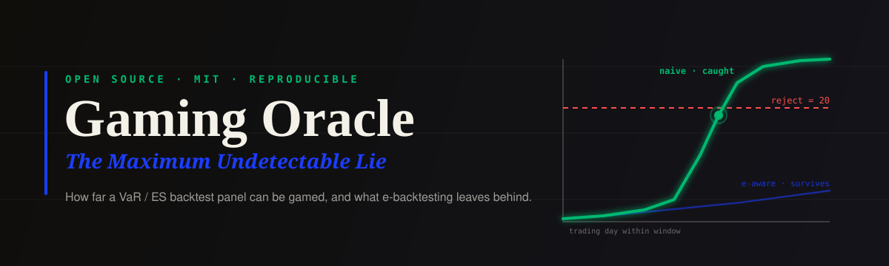
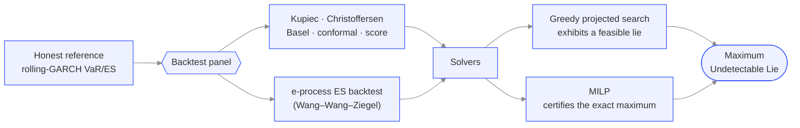
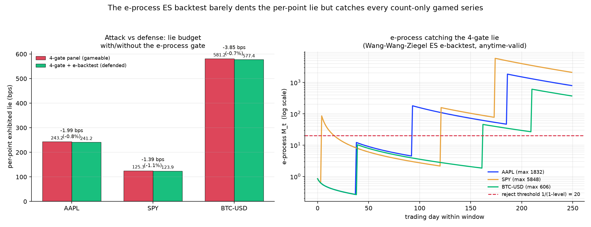
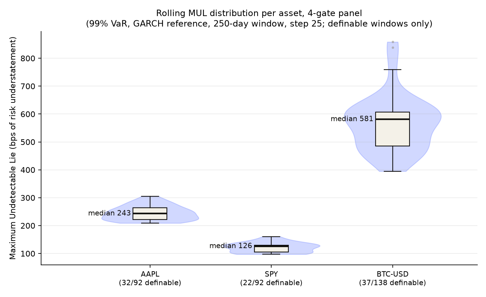

<div align="center">



<br/>

<a href="#install"></a>


<h3>Given the exact panel of backtests a risk validator runs, construct the most<br/>risk-understating VaR series that still passes <em>every</em> test, and price the gap.</h3>

<a href="#-what-it-does">What it does</a> ·
<a href="#-results">Results</a> ·
<a href="#install">Install</a> ·
<a href="#reproduce">Reproduce</a> ·
<a href="#-how-it-works">How it works</a>

</div>

---

## 🎯 What it does

A validation number ("the model passed backtesting") is only evidence if the check
that produced it could have failed for the right reason. **Gaming Oracle** turns that
into a constructive question: given a fixed backtest panel, what is the *worst* the
reported risk can be while the panel still shows all green?

The headline metric is the **Maximum Undetectable Lie (MUL)** — the largest VaR
understatement that evades a fixed validation panel, priced three ways:

<div align="center">

| basis points | dollars | exceptions |
|:---:|:---:|:---:|
| of the honest reference | on a stated notional | tolerated per year |

</div>



## 📊 Results

On the most recent 250-day **AAPL** window at the 99% level, a greedy construction
hides **249 bps** — about **\$24.9M on a \$1B notional** — with every regulatory gate
green. The mixed-integer program certifies the exact maximum over the linear gates.

<div align="center">

| Asset (250-day window) | Greedy MUL | Exact (MILP) | Survives the *e*-defended panel |
|:---|---:|---:|---:|
| **AAPL** | 243 bps | 313 bps | 241 bps |
| **SPY** | 125 bps | 166 bps | 124 bps |
| **BTC-USD** | 581 bps | 759 bps | 577 bps |

</div>

The anytime-valid *e*-process ES backtest catches the **naive** attacker outright
(its process blows past the rejection threshold), but removes only **~1%** of the lie
from an **e-aware** attacker — the surviving understatement is budget-dependent, not a
single number.

<div align="center">

<br/><em>Left: the e-gate barely dents the per-point lie. Right: the naive count-only gamed series is caught.</em>
<br/><br/>

<br/><em>The MUL is a distribution across definable rolling windows, not one cherry-picked window.</em>
</div>

## Install

Requires Python 3.11+ and [uv](https://docs.astral.sh/uv/).

```bash
uv sync
```

## Reproduce

```bash
# Headline: most-recent 250-day AAPL window at 99%, rolling-GARCH reference
uv run python -m gaming_oracle.cli --headline

# Per-asset representative windows, tolerance map, and the e-aware residual
uv run python -m gaming_oracle.cli --cycle 7

# Uniform vs greedy vs exact (MILP)
uv run python -m gaming_oracle.cli --cycle 3 --method rolling_garch

# Rolling-window MUL distribution
uv run python -m gaming_oracle.cli --cycle 2 --method rolling_garch

# Regenerate the figures
uv run python -m gaming_oracle.figures
```

Every reported number is reproducible offline from the cached returns in
`data_cache/`; no network access or paid data is required.

```bash
uv run pytest      # the full test suite
```

## 🔬 How it works

<details>
<summary><b>The optimization program</b></summary>

<br/>

Let the realized loss be `ℓ_t` and let `V*_t` be an honest reference VaR. The attacker
picks a stated series `V_t ≤ V*_t` maximizing the mean understatement subject to the
whole panel passing jointly. Every count-based gate reads `V` only through its
exception vector, so for a fixed set of exceptions the deepest under-reservation is
closed-form per day: drop `V_t` to `0` on a conceded exception, or to the realized
loss on a non-exception. The gain from conceding a day equals that day's loss, so the
objective is **linear** in the exception vector.

</details>

<details>
<summary><b>Two solvers, one certificate</b></summary>

<br/>

- **Greedy projected search** shrinks a scalar until a gate is about to flip, then
  presses each day down individually, re-validating the full panel from scratch. It
  *exhibits* a feasible lie; it does not claim optimality.
- **MILP** solves the linear (count and window) gates to a certified optimum with
  `scipy.optimize.milp`. The one nonlinear gate (Christoffersen independence) is
  verified post hoc on the optimal exception vector; the word "maximum" is used only
  when it passes.

</details>

<details>
<summary><b>The e-process ES backtest, and why it is not complete</b></summary>

<br/>

The Wang–Wang–Ziegel *e*-process reads breach *magnitude*, so it catches the attacker
that collapses stated VaR to zero on every breach. But an e-aware attacker that simply
declines to collapse the breaches keeps almost the entire lie, because the lie lives on
the calm days that are never breaches and that no magnitude test can see. The residual
that survives is a function of the attacker's self-imposed magnitude budget, not a
universal constant.

</details>

## 🧰 Also in this package

`gaming_oracle/leakage/` is a separate **lookahead-leakage auditor** for LLM and
agentic trading strategies — fake-date, entity-mask, and embargo probes that estimate
how much of a reported backtest is an artifact of the model having seen the future. Its
live-model adapter is intentionally held; the synthetic validation path runs fully
offline. See [`gaming_oracle/leakage/README.md`](gaming_oracle/leakage/README.md).

## 📎 Scope

Every backtest used here is prior work, cited in the accompanying paper, and is never
claimed as novel. The contribution is the constructive solver, the named and priced
metric, the tolerance map, and the measured e-aware residual. Every result is
**panel-relative and window-conditioned**: a lie is "undetectable" only against the
specific panel evaluated, on the specific window reported, and is never claimed as a
property of an asset in general.

## License

[MIT](LICENSE) © 2026 Sarthak Gupta

<div align="center">
<sub>Built for the paper <em>The Maximum Undetectable Lie: Constructing the Worst Value-at-Risk Series That a Backtest Panel Passes and the Limitations of E-Backtesting</em>.</sub>
</div>
